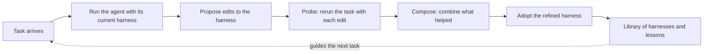

<h3 align="center">
  harness2-hermes-port<br>
  A Hermes Agent executor for Harness²
</h3>

<p align="center">
  <a href="https://arxiv.org/pdf/2610.14224"></a>
  <a href="docs/QUICKSTART.md"></a>
  <a href="LICENSE"></a>
</p>

<p align="center">
  <em>An independent port of <a href="https://github.com/google-research/harness2">Harness²</a> - not from the original authors.</em>
</p>


A **harness** is the system around a model that enables it to act as an agent:
prompts, tools, memory, skills, orchestration, and more. **Harnessing** is the
process of optimizing that system.

[Harness²](https://github.com/google-research/harness2) is Google Research's
framework for **recursive agent harnessing** in an open world
([paper](https://arxiv.org/abs/2610.14224)). It connects two levels of
recursion while keeping model weights fixed:

* **Task-level recursion** refines the execution harness for the current task
  through a contrastive **Propose–Probe–Compose** step: propose edits, probe
  their effects on the same task, and compose a refined harness from behavioral
  contrasts between executions, without ground-truth feedback.
* **Harnessing-level recursion** updates a persistent *improvement harness*
  with adopted harnesses and evidence-supported lessons from each task to guide
  future refinement.

This repository is an **independent port** that lets Harness² improve
[Hermes Agent](https://github.com/NousResearch/hermes-agent) agents, alongside
upstream's OpenCode and Codex executors. It is not a Google project and is not
endorsed by the Harness² authors. A sibling port does the same for Claude Code
at the **harness2-claude-port** repository, published under the same GitHub
account.

## Contents

- [The idea in plain terms](#the-idea-in-plain-terms)
- [How one task goes](#how-one-task-goes)
- [Experiments](#experiments)
- [What Hermes brings](#what-hermes-brings)
- [Where Hermes needed workarounds](#where-hermes-needed-workarounds)
- [Keeping the scores honest](#keeping-the-scores-honest)
- [What the validation showed](#what-the-validation-showed)
- [Going further](#going-further)
- [Citation](#citation)
- [Contributing](#contributing)
- [License](#license)
- [Disclaimer](#disclaimer)

## The idea in plain terms

Most ways of making an AI agent better change the model itself, by training it
on more data. Harness² leaves the model alone and improves everything around
it instead: the instructions it starts with, the notes it can consult, the
small tools and scripts it is handed, and the helpers it can delegate to.

Think of a capable new hire. You cannot change how smart they are, but you can
give them a better briefing, a better checklist and better tools. Harness²
does that automatically, one task at a time, and keeps a record of what helped
so the next task starts from a better place.

The unusual part is that it does this **without an answer key**. It never
looks at the correct answer to a task. It learns by comparing: it runs the
same task with slightly different setups, looks at how the agent behaved
differently in each, and keeps the changes that look like they helped.

## How one task goes



1. **Run.** The agent attempts the task with its current harness.
2. **Propose.** A second model, the improver, reads what happened and suggests
   edits: a clearer instruction, a new checklist item, a helper script.
3. **Probe.** Each suggested edit is tried on the same task, so the runs can
   be compared side by side.
4. **Compose.** The improver looks at how behavior differed between the runs
   and builds one refined harness from the edits that made a difference.
5. **Remember.** The adopted harness and a short written lesson go into a
   library, which the improver consults on later tasks.

Steps 2 to 4 are the task-level recursion from the paper. Step 5 is the
harnessing-level recursion: the system gets better at improving itself, not
just at the task in front of it.

## Experiments

There are two ways to spend more effort on a task. **Parallel recursion**
tries several candidate harnesses at once and composes a refinement from all
of their evidence. **Sequential recursion** takes the refined harness and runs
Propose–Probe–Compose on it again, several times in a row. The
[experiment guide](docs/EXPERIMENTS.md) covers both, plus task selection,
reproducibility and baselines. The upstream benchmarks (JobBench, LAB,
WorkBuddy-Bench) are described in the [benchmark guides](docs/BENCHMARKS.md);
that code is unchanged here and was not rerun for this port.

## What Hermes brings

Harness² describes a harness as eight editable parts: **system prompt,
guardrails, memory, tool guidance, subagents, skills, scripts and plugins**.
Each one is mapped onto a file Hermes reads natively:

| Part of the harness | Where it lives in Hermes |
|---|---|
| System prompt, guardrails, tool guidance | `SOUL.md`, the agent's identity file |
| Memory | `memories/MEMORY.md` |
| Skills | `work/skills/` |
| Scripts | `work/scripts/` |
| Subagents | A skill holding each helper's brief (see below) |
| Plugins | Shell hooks in `hooks.json` |

Each attempt runs in a throwaway Hermes home built from those files. Your own
Hermes home, with its settings, memories, skills and history, is never read.

## Where Hermes needed workarounds

Two of the eight parts do not fit Hermes directly, and the port says so
rather than hiding it:

* **Hermes has no named helper agents.** It can hand work to a child agent,
  but the child starts with Hermes's default identity and cannot be given a
  name or a file of its own. So each harness subagent becomes a skill that
  holds its brief, and `SOUL.md` tells the agent to pass that brief along when
  it delegates. Whether the brief is used depends on the model following that
  instruction; the conformance probe checks that it did.
* **Hermes keeps memory short by default**, about 2,200 characters. The port
  raises the cap to 20,000 so a harness's memory loads whole.

## Keeping the scores honest

An agent that edits its own setup could, in principle, edit its way around
the test. The port puts three guards in place:

* **A fixed floor.** Every attempt starts from settings that no harness edit
  can reach. Commands that would need a human's approval are refused, and
  Hermes's own background helpers (self-review, memory and skill nudges, the
  curator and bundled skills) are switched off so they cannot muddy the
  comparison. Credentials are passed in only by name, and nothing else from
  your environment is.
* **Hidden checkers.** On macOS, the operating system's sandbox stops every
  attempt from reading the scoring scripts, the run history and other runs'
  results, including any route through another process.
* **A clean history.** Before publishing, a pre-flight check scans the whole
  git history for secrets, private paths and stray Hermes home files.

Two limits are worth knowing. Hermes hooks are shell commands, and putting the
operator's hooks first is an ordering, not a hard wall. Hermes also passes
some credentials on to the agent's terminal, so use a key you can revoke and,
if attempts must not see your files, run them as a separate user. Agents in
these runs can also use the internet, and some public benchmark rubrics are
online, so a strictly clean evaluation needs
[network restrictions](docs/EXPERIMENTS.md#web-access).

## What the validation showed

The port adds **localbench**, 12 small tasks in three areas (cleaning data,
pulling a table out of a document, fixing a bug in a small repository), each
scored by a fixed script rather than by another model. That makes it cheap to
check the whole system end to end.

Hermes ran all 12 tasks twice, with the tasks shuffled into a different order
each time:

| Run | Tasks completed | Score before | Score after | Lessons saved | Agent cost | Improver cost |
|---|---|---|---|---|---|---|
| Order 1 | 12/12 | 100 | 100 | 10 | unknown | $10.47 |
| Order 2 | 12/12 | 100 | 100 | 9 | unknown | $9.76 |

The agent model was `claude-haiku-5-5` running inside Hermes, and the
improver `claude-opus-5-5`. The agent cost is unknown because Hermes reports
no price on a subscription login; the runs recorded token counts instead. A
separate probe confirmed that all eight harness parts reach a real attempt and
that the floor holds.

Read the scores carefully: the agent already solved every task before any
improvement, so there was nothing left to gain. These runs show the machinery
works from start to finish. They do **not** show that Harness² makes Hermes
better; that needs harder tasks. [VALIDATION.md](VALIDATION.md) has every
command, probe and receipt.

## Going further

* [Quick start](docs/QUICKSTART.md): install, run the offline demo, and try
  the Hermes executor.
* [Setup guide](docs/SETUP.md): requirements, credentials and the upstream
  benchmarks.
* [Experiment guide](docs/EXPERIMENTS.md): recursion modes, cost, results and
  resuming a run.
* [Upstream changes](UPSTREAM.md): every upstream file this port modifies, and
  why.

## Citation

Cite the Harness² paper:

```bibtex
@article{xu2026harness2,
  title   = {Harness$^2$: Recursive Agent Harnessing for an Open World},
  author  = {Xu, Ruiyao and Chen, Yanfei and CuiZhu, Zhongying and Dalvi Mishra, Bhavana and Ming, Yifei and Yu, Han and Han, Rujun and Lee, Chen-Yu and Pfister, Tomas},
  journal = {arXiv preprint arXiv:2610.14224},
  year    = {2026},
  url     = {https://arxiv.org/abs/2610.14224}
}
```

## Contributing

See [CONTRIBUTING.md](CONTRIBUTING.md). Coding agents should read
[AGENTS.md](AGENTS.md) first.

## License

Apache 2.0, the same license as upstream; see [LICENSE](LICENSE) and
[NOTICE](NOTICE). Code under [`third_party/`](third_party/README.md),
benchmarks and datasets keep their own licenses; see the
[third-party notices](dependencies/README.md). The Harness² logo, wordmark,
figures and video are not included. Modified by The harness2-ports Authors:
this README replaces the upstream one, which is in the
[upstream repository](https://github.com/google-research/harness2).

## Disclaimer

This is an independent port, not an officially supported Google product, and it
is not endorsed by the Harness² authors.
